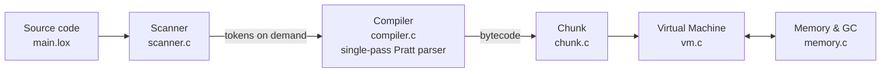
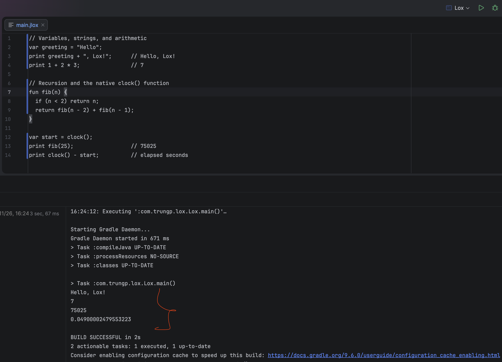

# clox — A Bytecode Compiler & Virtual Machine for Lox


A complete implementation of **clox**, the single-pass compiler and stack-based bytecode virtual machine for the **Lox** programming language. I wrote it in C from scratch, following Part III of Robert Nystrom's [*Crafting Interpreters*](https://craftinginterpreters.com).

> 🔜 **Status: partially completed.** Classes and Garbage Collector are not yet implemented (I will add soon).

---

## Table of Contents

1. [Introduction](#1-introduction)
2. [The Lox Language](#2-the-lox-language)
3. [What I Built](#3-what-i-built)
4. [Demo: Compiling and Running `main.lox`](#4-demo-compiling-and-running-mainlox)
5. [Acknowledgements](#acknowledgements)

---

## 1. Introduction

**clox** takes Lox source code, compiles it to compact **bytecode**, and runs that bytecode on a **stack-based virtual machine**. It does all of this in one pass and never builds a syntax tree. That makes it much faster than a tree-walking interpreter. It's the same basic design that CPython, Lua, and the JVM use.

The whole thing is a few thousand lines of dependency-free C99. It covers every part a real language runtime needs:

- **A scanner** that turns source text into tokens as they're needed
- **A single-pass compiler** (a Pratt parser) that emits bytecode directly while it parses
- **A virtual machine** with a value stack, call frames, and a tight dispatch loop
- **A memory manager** with a tracing **mark-and-sweep garbage collector**
- **A runtime** for strings, functions, closures, classes, instances, and bound methods

You can run it as an interactive **REPL** or point it at a `.lox` file.

---

## 2. The Lox Language

Lox is a small, **dynamically typed**, **garbage-collected** scripting language with C-family syntax. It supports first-class functions, closures, and classes with single inheritance.

### 2.1 A Taste of Lox

```lox
// Variables, strings, and arithmetic
var greeting = "Hello";
print greeting + ", Lox!";      // Hello, Lox!
print 1 + 2 * 3;                // 7

// Recursion and the native clock() function
fun fib(n) {
  if (n < 2) return n;
  return fib(n - 2) + fib(n - 1);
}

var start = clock();
print fib(25);                  // 75025
print clock() - start;          // elapsed seconds
```

### 2.2 Grammar

<details>
<summary>Click to expand</summary>

```ebnf
program     → declaration* EOF ;

declaration → classDecl | funDecl | varDecl | statement ;
classDecl   → "class" IDENTIFIER ( "<" IDENTIFIER )? "{" function* "}" ;
funDecl     → "fun" function ;
varDecl     → "var" IDENTIFIER ( "=" expression )? ";" ;

statement   → exprStmt | forStmt | ifStmt | printStmt
            | returnStmt | whileStmt | block ;
forStmt     → "for" "(" ( varDecl | exprStmt | ";" )
                        expression? ";" expression? ")" statement ;
ifStmt      → "if" "(" expression ")" statement ( "else" statement )? ;
printStmt   → "print" expression ";" ;
returnStmt  → "return" expression? ";" ;
whileStmt   → "while" "(" expression ")" statement ;
block       → "{" declaration* "}" ;
exprStmt    → expression ";" ;

expression  → assignment ;
assignment  → ( call "." )? IDENTIFIER "=" assignment | logic_or ;
logic_or    → logic_and ( "or" logic_and )* ;
logic_and   → equality ( "and" equality )* ;
equality    → comparison ( ( "!=" | "==" ) comparison )* ;
comparison  → term ( ( ">" | ">=" | "<" | "<=" ) term )* ;
term        → factor ( ( "-" | "+" ) factor )* ;
factor      → unary ( ( "/" | "*" ) unary )* ;
unary       → ( "!" | "-" ) unary | call ;
call        → primary ( "(" arguments? ")" | "." IDENTIFIER )* ;
primary     → "true" | "false" | "nil" | "this"
            | NUMBER | STRING | IDENTIFIER | "(" expression ")"
            | "super" "." IDENTIFIER ;

function    → IDENTIFIER "(" parameters? ")" block ;
parameters  → IDENTIFIER ( "," IDENTIFIER )* ;
arguments   → expression ( "," expression )* ;
```

</details>

## 3. What I Built

### 3.1 Architecture



The compiler asks the scanner for one token at a time and writes bytecode straight into a **chunk**. There's no syntax tree in between. The VM then runs the chunk, and the garbage collector frees any heap objects the program can no longer reach.

### 3.2 Implementation Highlights

- **Single-pass compilation.** The Pratt parser writes bytecode as it parses, without building an AST. Each token type maps to a prefix rule, an infix rule, and a precedence level.
- **Global/local variable scoping.** This part is confusing, but I managed to complete it with a proper understanding of why.
### 3.3 Instruction Set

<details>
<summary>37 opcodes (click to expand)</summary>

| Group                  | Opcodes |
|------------------------|---------|
| Constants & literals   | `OP_CONSTANT` `OP_NIL` `OP_TRUE` `OP_FALSE` |
| Stack                  | `OP_POP` |
| Variables              | `OP_GET_LOCAL` `OP_SET_LOCAL` `OP_GET_GLOBAL` `OP_DEFINE_GLOBAL` `OP_SET_GLOBAL` `OP_GET_UPVALUE` `OP_SET_UPVALUE` |
| Properties             | `OP_GET_PROPERTY` `OP_SET_PROPERTY` `OP_GET_SUPER` |
| Comparison             | `OP_EQUAL` `OP_GREATER` `OP_LESS` |
| Arithmetic & logic     | `OP_ADD` `OP_SUBTRACT` `OP_MULTIPLY` `OP_DIVIDE` `OP_NOT` `OP_NEGATE` |
| Output                 | `OP_PRINT` |
| Control flow           | `OP_JUMP` `OP_JUMP_IF_FALSE` `OP_LOOP` |
| Functions & closures   | `OP_CALL` `OP_INVOKE` `OP_SUPER_INVOKE` `OP_CLOSURE` `OP_CLOSE_UPVALUE` `OP_RETURN` |
| Classes                | `OP_CLASS` `OP_INHERIT` `OP_METHOD` |

There are no opcodes for `!=`, `<=`, and `>=`. The compiler builds them from the others: `a >= b` becomes `OP_LESS` followed by `OP_NOT`.

</details>

### 3.5 Project Structure

```
.
├── main.c          # Entry point: REPL and file runner
├── common.h        # Shared includes and debug flags
├── scanner.c/.h    # Lexer: source text → tokens
├── compiler.c/.h   # Single-pass Pratt compiler: tokens → bytecode
├── chunk.c/.h      # Bytecode chunk and constant pool
├── value.c/.h      # Value representation (NaN-boxed)
├── object.c/.h     # Heap objects: strings, functions, closures, classes…
├── table.c/.h      # Hash table (globals, fields, methods, string interning)
├── vm.c/.h         # The virtual machine
├── memory.c/.h     # Allocation and garbage collection
├── debug.c/.h      # Bytecode disassembler
└── main.lox        # Demo program
```

| Exit code | Meaning                       |
|:---------:|-------------------------------|
| `0`       | Success                       |
| `64`      | Usage error (bad arguments)   |
| `65`      | Compile error                 |
| `70`      | Runtime error                 |
| `74`      | Couldn't read the input file  |

### 3.6 Debug Flags
You can switch these on in `common.h`:

| Flag                    | Effect                                                           |
|-------------------------|------------------------------------------------------------------|
| `DEBUG_PRINT_CODE`      | Disassembles each function's bytecode after compiling it         |
| `DEBUG_TRACE_EXECUTION` | Prints the value stack and the current instruction at every step |
| `DEBUG_STRESS_GC`       | Runs the GC on every allocation to flush out memory bugs         |
| `DEBUG_LOG_GC`          | Logs every allocation, mark, and free                            |
| `NAN_BOXING`            | Switches between the NaN-boxed and tagged-union `Value`          |

For example, with `DEBUG_PRINT_CODE` on, `print 1 + 2;` disassembles to:

```
== <script> ==
0000    1 OP_CONSTANT         0 '1'
0002    | OP_CONSTANT         1 '2'
0004    | OP_ADD
0005    | OP_PRINT
0006    2 OP_NIL
0007    | OP_RETURN
```

---

## 4. Demo: Compiling and Running `main.lox`

The screenshot below shows clox compiling `main.lox` to bytecode and running it on the VM: \
### Build:
```bash
cmake -S . -B build        # configure: generate build files in ./build
cmake --build build        # compile and link
```
### Run
```bash
./build/clox main.lox      # run
```

<p align="center">
  
</p>

<p align="center"><em>clox running <code>main.lox</code> end to end.</em></p>

---

## Acknowledgements

- **Robert Nystrom** for [*Crafting Interpreters*](https://craftinginterpreters.com), the book this implementation follows, and for designing Lox.
